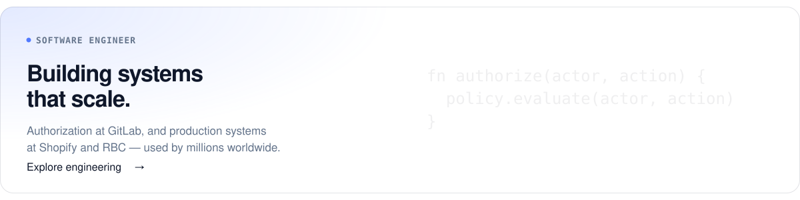
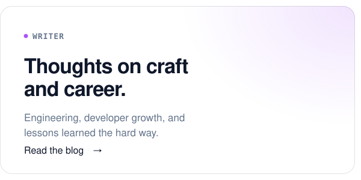
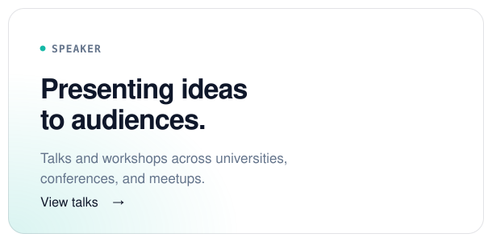
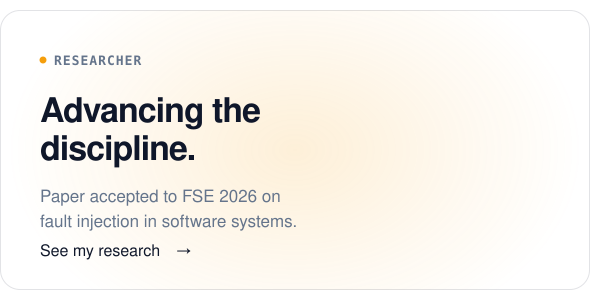
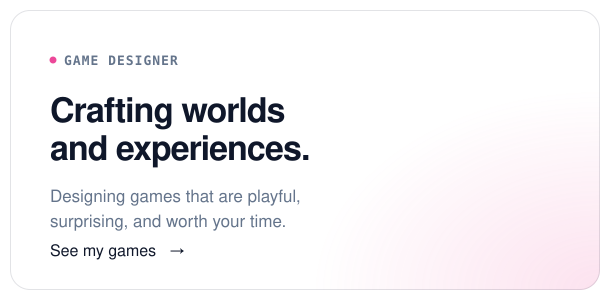

<a href="https://matthewmacraebovell.com"><picture><source media="(prefers-color-scheme: dark)" srcset="assets/hero-dark.svg"></picture></a>

<a href="https://matthewmacraebovell.com"><picture><source media="(prefers-color-scheme: dark)" srcset="assets/btn-website-dark.svg"></picture></a>&nbsp;<a href="https://matthewmacraebovell.com/blog"><picture><source media="(prefers-color-scheme: dark)" srcset="assets/btn-blog-dark.svg"></picture></a>&nbsp;<a href="https://matthewmacraebovell.com/presentations"><picture><source media="(prefers-color-scheme: dark)" srcset="assets/btn-talks-dark.svg"></picture></a>&nbsp;<a href="https://www.linkedin.com/in/matthewmacraebovell/"><picture><source media="(prefers-color-scheme: dark)" srcset="assets/btn-linkedin-dark.svg"></picture></a>&nbsp;<a href="https://calendly.com/matthewmacraebovell/chats"><picture><source media="(prefers-color-scheme: dark)" srcset="assets/btn-coffee-dark.svg"></picture></a>

### Hey, I'm Matthew 👋

I'm a software engineer from Ottawa, Canada, currently working on authorization at [GitLab](https://gitlab.com), with experience building production systems at companies like Shopify and RBC.

Outside of work you'll find me writing, speaking, researching, designing games, and exploring whatever's next.

<a href="https://matthewmacraebovell.com/software-engineer"><picture><source media="(prefers-color-scheme: dark)" srcset="assets/card-engineer-dark.svg"></picture></a>

<a href="https://matthewmacraebovell.com/blog"><picture><source media="(prefers-color-scheme: dark)" srcset="assets/card-writer-dark.svg"></picture></a><a href="https://matthewmacraebovell.com/presentations"><picture><source media="(prefers-color-scheme: dark)" srcset="assets/card-speaker-dark.svg"></picture></a>

<a href="https://matthewmacraebovell.com/research"><picture><source media="(prefers-color-scheme: dark)" srcset="assets/card-researcher-dark.svg"></picture></a><a href="https://matthewmacraebovell.com/games"><picture><source media="(prefers-color-scheme: dark)" srcset="assets/card-game-dark.svg"></picture></a>

<!-- Assets are generated by scripts/generate.py -->
